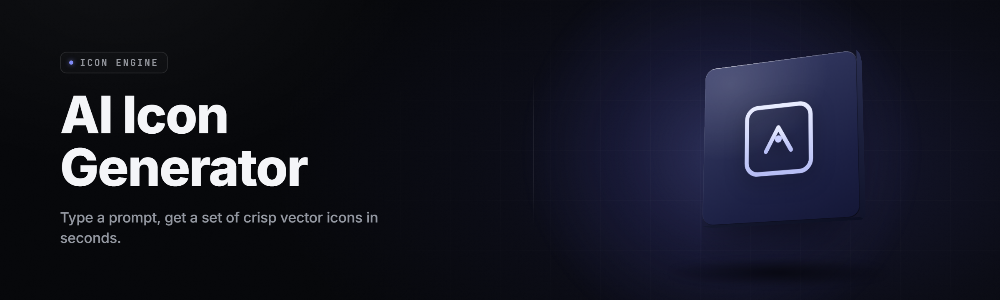

  
  
  

  

  
  

---

**Prompt in, production-ready icon set out. No design degree, no vector forensics, no bouncing between six apps.**

---

Absolute potato to Sam for the topic drop — stuck 43 modules into this one, watch me cook. Quick rundown before the long read: `ai-icon-generator-studio` is a native Windows `.exe` that takes your text prompt, reference image, or brand palette and outputs a full icon family — every size, every format, every state (default / hover / active / disabled / dark-mode) — packing `.ico`, `.icns`, `.svg`, `.png`, and Android/iOS density buckets into one export. No Python. No npm. No terminal. You download, you extract, you double-click the `.exe`, and a 512px app icon plus a 16px tray icon fall out the other side.
### ⬇️ Grab the current build

  

---

## 📋 Table of Contents

- [🔍 Overview](#-overview)
- [🧠 What is an AI Icon Generator?](#-what-is-an-ai-icon-generator)
- [🔥 The Problem](#-the-problem)
- [🧪 The Solution](#-the-solution)
- [🧩 Key Features](#-key-features)
- [⬇️ Get Started — Quick Start](#-get-started--quick-start)
- [📦 Installation](#-installation)
- [🎛️ Grouped Module Catalog](#️-grouped-module-catalog)
- [🗂️ All 43 Modules — Status Board](#️-all-43-modules--status-board)
- [⚖️ Comparison — Icon Studio vs the old way](#️-comparison--icon-studio-vs-the-old-way)
- [🖥️ System Requirements](#️-system-requirements)
- [🩹 Known Issues](#-known-issues)
- [🛠️ Tips for Best Results](#️-tips-for-best-results)
- [❓ FAQ](#-faq)

---

## 🔍 Overview

A dark-mode desktop workstation that turns prompts and reference art into a coherent, shippable icon library. Four generation engines, a batch rewriter, a diff-rasterizer for pixel-perfect variants, and a CLI-friendly atlas exporter — all wrapped around one `.exe`.

| Category | Details |
|---|---|
| **Project** | `ai-icon-generator-studio` |
| **Type** | Windows desktop app (single `.exe`, portable) |
| **Release year** | 2026 |
| **Core engines** | icon-diffusion v4 · style-transfer v2 · upscale v6 · vector-trace v3 |
| **Output families** | `.ico` · `.icns` · `.svg` · `.png` · `.webp` · `.pdf` atlas · Android `mipmap-*` · iOS `AppIcon.appiconset` |
| **Default canvas** | 1024 × 1024 (downscales clean to 16 × 16) |
| **Batch mode** | Up to 400 prompts per queue |
| **License** | MIT — personal & commercial output, no attribution required |
| **Hardware accel** | CUDA 12+, DirectML, or pure CPU fallback |

Most icon tools make you fight DPI math by hand. This one resolves the whole multi-size ladder from a single source pass, so your 16px tray icon and 1024px store banner are rendered from the same latent — no mismatched silhouettes, no fuzzy edges at the tiny end.

---

## 🧠 What is an AI Icon Generator?

| Term | Explanation |
|---|---|
| **Latent icon pass** | The engine's first render — a high-dimensional draft of your icon before it's sliced into sizes. |
| **Raster ladder** | The automatic set of pixel sizes (16, 24, 32, 48, 64, 128, 256, 512, 1024) generated from one source. |
| **Vector trace** | Converting the flat-color render into scalable `.svg` paths without the usual stair-step junk. |
| **Style lock** | Freezing a seed + style so your 40-app icon family all reads like one designer made them. |
| **Alpha fence** | The mask that keeps the icon's background transparent *exactly* at your chosen margin — no bleed. |
| **State matrix** | Auto-generating hover / active / disabled / dark variants so a full UI set ships at once. |
| **Atlas** | A single packed sheet mapping every size to its offset — drop-in for engine texture pipelines. |

**Why teams reach for it:**

- 🔤 Hand it a wordmark once, get the whole icon family — no re-prompting per size.
- 🎯 Diff-screen every export against your source so nothing ships off-brand.
- 🧵 Vector trace output drops straight into Figma, Illustrator, or a code IDE.
- 🗃️ Group presets let one person manage a 300-icon product without a spreadsheet.
- 🌗 Dark/light state pairs generated in the same pass — no manual inversion cleanup.

---

## 🔥 The Problem

Most people build icons the slow way — and it shows in the seams.

- **The multi-app shuffle.** Sketch in one tool, recolor in another, export sizes in a third, then agonize over a 32px that turned to mush. Four apps, one bad result.
- **Prompt-to-size mismatch.** You generate a vibe at 1024px, then hand-scale down and watch your thin strokes collapse into noise. Nobody's tweaking per-rung.
- **Style drift.** You build nine nice icons, then the tenth comes back with a totally different light source and the whole tray looks like two teams collided.
- **Format zig-zag.** Windows wants `.ico`, macOS wants `.icns`, web wants `.svg`, Android wants six density buckets. Doing each by hand is a lost afternoon.
- **State-blind exports.** Your button icon has no hover state, no disabled grey, no dark-mode swap — so the front-end rebuilds it anyway.
- **Licensing landmines.** Grab a random generator off the web, ship it, discover the fine print bans commercial use.
- **Tray-ICON hell.** The one size everybody forgets is 16px — and it's the one that breaks the hardest.

---

## 🧪 The Solution

| Problem | Solution in Icon Studio |
|---|---|
| Multi-app shuffle | One `.exe` — generate, recolor, export, atlas all in one window. |
| Size mismatch | Raster ladder renders each rung from the source latent, not a downscale. |
| Style drift | Style lock freezes seed + palette across the whole batch. |
| Format zig-zag | One-click family export writes `.ico`, `.icns`, `.svg`, `.png`, Android + iOS buckets together. |
| State-blind exports | State matrix auto-generates default / hover / active / disabled / dark in one click. |
| Licensing landmines | MIT output — personal or commercial, your art, no attribution. |
| Tray size breakdown | Dedicated fine-line guard sharpens 16–32px rungs automatically. |

---

## 🧩 Key Features

| Feature | Description | Benefit |
|---|---|---|
| **Prompt Forge** | Text-to-icon with style tokens (`flat`, `neumorphic`, `glass`, `pixel`, `line`, `isometric`). | Describe an icon, get one in your palette. |
| **Reference Clone** | Drop an existing icon; the engine rebuilds it in your target style at every size. | Rebrand a family without redrawing. |
| **Palette Lock** | Pin hex values; output only uses your brand colors. | On-brand by construction. |
| **Style Lock** | Freeze a seed so a 40-icon family reads as one designer. | No more visual collisions. |
| **Raster Ladder** | Auto 16→1024 rung set from one source. | Kill the manual downscale chore. |
| **Vector Trace** | Flat renders become scalable `.svg` paths. | Ship vector + raster from one pass. |
| **State Matrix** | Auto hover / active / disabled / dark variants. | Front-end never rebuilds a state. |
| **Atlas Exporter** | Packed sheet + JSON offset map for game/UI pipelines. | Drop-in texture sprite. |
| **Batch Queue** | Paste 400 prompts, walk away, come back to 400 families. | Whole product set in one run. |
| **Overlay Studio** | Add badges, dot-indicators, status corners to any render. | One icon, infinite states. |
| **Alpha Fence** | Precise transparency margin control. | No preview bleed, no halo edges. |
| **CLI Mode** | Headless flag for CI builds. | Icons auto-rebuild on commit. |

---

## ⬇️ Get Started — Quick Start

Three minutes from download to first icon set.

1. 📥 **Download** the release package from the landing page (see the button below).
2. 📂 **Extract** the `.exe` and its asset folder into any writable directory — no installer, no registry writes.
3. 🚀 **Run** the `.exe` — first launch asks GPU vs CPU; pick GPU if you have CUDA or DirectML.
4. ✍️ **Type a prompt** like `flat rounded app icon, blue-to-teal gradient, coffee cup, soft shadow`, set canvas 1024, hit **Generate**.
5. 📦 **Export family** — click the rung chip set you want (`.ico 16–256`, `.png 1024`, `.svg`, Android, iOS) and choose your output folder.

### ⬇️ Current release package

  

---

## 📦 Installation

1. **Grab the package.** Head to the project landing page and pull the latest release zip. The package is portable — nothing gets installed system-wide unless you opt into the shell integration during first run.
2. **Extract, don't nest.** Unzip to a folder whose path has **no spaces and no non-ASCII characters** if you plan to use CLI mode. The asset folder must sit next to the `.exe`.
3. **First-run choice.** On launch you'll pick a backend: **CUDA** (fastest, needs an NVIDIA driver ≥ 555), **DirectML** (any modern GPU, broader support), or **CPU** (slow but runs anywhere). You can switch later in Settings — the app re-warms models on the fly.

> GPU users: the first run downloads model weights (~2.1 GB) into the app folder. Keep it on an SSD — SD-card launches crawl during weight load.

---

## 🎛️ Grouped Module Catalog

All 43 modules, grouped by the job they do. Each group is its own workspace inside the app.

### 🎨 Generation Modules (1–9)

1. **Prompt Forge** — text-to-icon entry point; supports weighted tokens like `(flat:1.4)`.
2. **Style Token Bank** — 60+ canned styles across flat, glass, neumorphic, pixel, line-art, isometric, skeuomorphic.
3. **Seed Lock** — fix the RNG so repeat runs return the same render.
4. **Variation Spray** — generate a 12-up contact sheet from one prompt to pick a winner.
5. **Reference Clone** — rebuild an existing icon in your target style.
6. **Sketch-to-Icon** — drop a napkin doodle, get a finished ground-truth icon.
7. **Palette Injection** — feed a 4–8 hex brand palette; the engine constrains every render to it.
8. **Negative Prompting** — list what you *don't* want (e.g. `no gradients`, `no text`) and it stays out.
9. **Aspect Forge** — square, circle-safe, wide-banner, and vertical icon frames from the same prompt.

### 🔧 Post-Process Modules (10–18)

10. **Raster Ladder** — automatic rung generation 16→1024 from one source.
11. **Vector Trace** — flat renders → scalable `.svg` paths.
12. **Alpha Fence** — control transparency margin to the pixel.
13. **Fine-Line Guard** — re-sharpens thin strokes at 16–32px rungs so tiny sizes survive.
14. **Color-Reduce** — snap output to a target palette size (8 / 16 / 32 colors) for tiny icons.
15. **Halo Check** — detect leftover light fringe on transparent edges and auto-clean it.
16. **Shadow Drop** — parametrizable soft/hard drop shadow generator.
17. **Rounding Pass** — corner radius applied uniformly across the whole rung set.
18. **Upscale Pass** — bring a 256px source up to 1024 without the usual smear.

### 🗂️ Export & Packaging Modules (19–27)

19. **`.ico` Writer** — multi-size ICO up to 256px with per-size bit-depth control.
20. **`.icns` Writer** — macOS bundle with retina variants.
21. **SVG Writer** — clean-path SVG output, no cruft metadata.
22. **PNG Ladder** — every rung as its own PNG, filename templated.
23. **WebP Writer** — modern web export with alpha.
24. **Android Exporter** — writes the full `mipmap-mdpi` → `mipmap-xxxhdpi` tree.
25. **iOS Exporter** — emits `AppIcon.appiconset` + `Contents.json`.
26. **PDF Atlas** — single-page PDF contact sheet of the whole family for review.
27. **Sprite Atlas** — packed sheet + JSON offset map for game-engine consumption.

### 🔤 Logomark & Wordmark Modules (28–34)

28. **Glyph Forge** — single-letter / monogram icon generation with consistent baselines.
29. **Wordmark Fit** — auto-fit a short word inside a badge at every size.
30. **Negative-Space Eng** — carve a shape out of a filled icon (the old FedEx-arrow trick).
31. **Badge Stacker** — corner dot, notification bubble, and status ribbon overlays.
32. **Brand Kit Reader** — read a palette + logo from a folder and constrain output to it.
33. **Monochrome Pass** — single-tint render for tray / taskbar contexts.
34. **Invert Match** — auto-generate the dark-mode counterpart of every icon.

### ⚙️ Pipeline & Automation Modules (35–43)

35. **Batch Queue** — paste up to 400 prompts, run overnight, wake up to families.
36. **Group Presets** — bundle a task-type + palette + seed as a reusable preset.
37. **Style Lock** — freeze the look across an entire product's icon set.
38. **CLI Mode** — headless run for CI: `studio --prompt-file icons.txt --out ./dist`.
39. **Watch Folder** — drop a prompt file, walk away, output appears auto-generated.
40. **Export Recipe** — save a “ship this exact bundle” recipe for recurring builds.
41. **Diff Rasterizer** — compare an old icon family to the new one and flag drifted icons.
42. **History Log** — every generation stored with prompt + seed + timestamp.
43. **One-Click Rebuild** — re-run the last job with a single keypress after a palette tweak.

---

## 🗂️ All 43 Modules — Status Board

| Module | Status | Description |
|---|---|---|
| Prompt Forge | ✅ Working | Core text-to-icon entry; weighted token support. |
| Style Token Bank | ✅ Working | 60+ styles; custom styles can be dropped in as JSON. |
| Seed Lock | ✅ Working | RNG freeze; reproducible renders. |
| Variation Spray | ✅ Working | 12-up contact sheet generator. |
| Reference Clone | ✅ Working | Style-transfer from a dropped image. |
| Sketch-to-Icon | ⚠️ Beta | Best on bold doodles; fine pencil strokes need a scan. |
| Palette Injection | ✅ Working | Hex-constrained render. |
| Negative Prompting | ✅ Working | Exclusion tag list. |
| Aspect Forge | ✅ Working | Multi-frame icon from one prompt. |
| Raster Ladder | ✅ Working | Auto 16→1024 rung set. |
| Vector Trace | ✅ Working | Flat render → `.svg`. |
| Alpha Fence | ✅ Working | Transparency-margin control. |
| Fine-Line Guard | ✅ Working | Tiny-size stroke resharpen. |
| Color-Reduce | ✅ Working | Palette-size snapping. |
| Halo Check | ✅ Working | Edge-fringe auto-clean. |
| Shadow Drop | ✅ Working | Parametric drop shadow. |
| Rounding Pass | ✅ Working | Uniform corner-radius rung set. |
| Upscale Pass | ✅ Working | 256→1024 source lifter. |
| `.ico` Writer | ✅ Working | Multi-size ICO. |
| `.icns` Writer | ✅ Working | macOS bundle export. |
| SVG Writer | ✅ Working | Clean-path vector out. |
| PNG Ladder | ✅ Working | Every rung as PNG. |
| WebP Writer | ✅ Working | Modern web export. |
| Android Exporter | ✅ Working | Full `mipmap-*` tree. |
| iOS Exporter | ✅ Working | `AppIcon.appiconset` writer. |
| PDF Atlas | ✅ Working | Single-page contact sheet. |
| Sprite Atlas | ✅ Working | Packed sheet + JSON offsets. |
| Glyph Forge | ✅ Working | Monogram generation. |
| Wordmark Fit | ⚠️ Beta | Auto-fit short words; hyphenation incomplete. |
| Negative-Space Eng | ✅ Working | Carved-shape icons. |
| Badge Stacker | ✅ Working | Dot / bubble / ribbon overlays. |
| Brand Kit Reader | ✅ Working | Palette + logo folder ingest. |
| Monochrome Pass | ✅ Working | Single-tint tray render. |
| Invert Match | ✅ Working | Auto dark-mode counterpart. |
| Batch Queue | ✅ Working | Up to 400-prompt overnight runs. |
| Group Presets | ✅ Working | Save-and-recall job presets. |
| Style Lock | ✅ Working | Cross-batch style consistency. |
| CLI Mode | ✅ Working | Headless CI run. |
| Watch Folder | ✅ Working | Auto-process on file drop. |
| Export Recipe | ✅ Working | Save a ship bundle to reuse. |
| Diff Rasterizer | ✅ Working | Old-vs-new family comparison. |
| History Log | ✅ Working | Full prompt/seed/timestamp log. |
| One-Click Rebuild | ✅ Working | Last-job re-run on palette change. |

---

## ⚖️ Comparison — Icon Studio vs the old way

| Aspect | Old way (buy / install / manual) | This tool (`ai-icon-generator-studio`) |
|---|---|---|
| **Setup** | Install a vector app, a raster app, an exporter, a bundler. | One `.exe`, extract, run. |
| **Icon source** | Hand-drawn or bought packs. | Prompt, reference, or sketch → generation. |
| **Sizing** | Manual downscale per rung, edge cleanup by eye. | Raster Ladder renders each rung from source. |
| **Style consistency** | Two designers, two light sources, awkward tray. | Style Lock freezes the look across the batch. |
| **Format exports** | Per-tool export dialogs, one format at a time. | One family export writes 7 format families at once. |
| **State variants** | Front-end rebuilds each button state by hand. | State Matrix auto-generates all five. |
| **Licensing** | Editorial packs with usage fine print. | MIT output — commercial-friendly, no attribution. |
| **Rebuild cost** | Re-do the whole thing when brand colors shift. | One-Click Rebuild on the palette sweep. |

---

## 🖥️ System Requirements

| Component | Minimum | Recommended |
|---|---|---|
| **OS** | Windows 10 x64 (1809+) | Windows 11 x64 |
| **CPU** | Quad-core 2.5 GHz | 8-core 3.5 GHz+ |
| **RAM** | 8 GB | 16 GB |
| **GPU** | DirectML-capable (Intel HD / any modern) | NVIDIA RTX 3060+ / 12 GB VRAM |
| **DirectX** | DX 12 | DX 12 Ultimate |
| **Disk** | 4 GB free (app + CPU models) | 15 GB SSD (CUDA models + caches) |
| **Display** | 1280 × 720 | 1920 × 1080+ |

---

## 🩹 Known Issues

| Issue | Solution |
|---|---|
| First-run weight download stalls behind a proxy. | Set `HTTPS_PROXY` before launch, or use offline-model mode (`--offline`). |
| CLI mode produces empty output when path contains spaces. | Quote the path or run from a directory whose full path has no spaces. |
| CUDA backend crashes on driver < 555. | Update the NVIDIA driver or switch to DirectML in Settings. |
| `Sketch-to-Icon` blurs fine pencil lines. | Scan at ≥ 600 DPI and bump the `--clean` flag; OCR pre-pass in the next release. |
| Batch runs drop below 400 prompts. | Ensure the prompt file is newline-delimited UTF-8, not CSV. |
| `.icns` export fails silently on read-only folders. | Confirm write permission or point the out-path at your home directory. |

---

## 🛠️ Tips for Best Results

- Give the engine a palette before a style token; brand constraints win ties.
- For app icon sets, generate the 256px rung first, then let the Raster Ladder fill below it — you'll get cleaner edges at 16px.
- Keep negative prompts tight: `no text, no gradients, no bezels` cleans up almost any flat-icon render.
- Batch work in product-sized chunks (10–40 icons) so Style Lock isn't asked to stretch across mismatched palettes.
- Always ship the `.svg` alongside the `.png` — future you will want the vector.
- In CLI mode, pair `History Log` with your git commit hash by writing the seed into a text file next to the output.

---

## ❓ FAQ

Do I need Python, Node, or a package manager to run this?

No. The release is a portable Windows `.exe` plus an asset folder. Extract, double-click, done. No pip, no npm, no build step.

Can I ship the generated icons commercially?

Yes. The project is MIT-licensed and the output is your art — commercial use, no attribution required.

Does it work without an NVIDIA GPU?

Yes — DirectML covers AMD and Intel GPUs, and there's a pure-CPU fallback. It's slower but produces identical output.

How many icons can I generate in one batch?

Batch Queue is capped at 400 prompts per run. Break larger sets into separate runs; each run preserves its own seed and palette.

Can I keep the whole set visually consistent across a 40-icon family?

That's what Style Lock is for — it freezes the seed + palette so a whole product's icon tray reads as one designer's work.

Which formats does the family export write?

`.ico`, `.icns`, `.svg`, `.png`, `.webp`, PDF atlas, Android `mipmap-*` buckets, iOS `AppIcon.appiconset`, and a packed sprite atlas with JSON offsets.

Is there a headless / CI mode?

Yes. Run `studio --prompt-file icons.txt --out ./dist --headless` from a build step to regenerate icon families automatically when your palette changes.

How does Sketch-to-Icon compare to full text-to-icon?

Sketch-to-Icon is best on bold, confident lines. Pencil-light sketches want a 600 DPI scan and a cleanup pass. It's marked beta for that reason.

Can I point it at my brand assets folder and constrain every render?

Yes — Brand Kit Reader ingests a palette file + your existing logo, and every subsequent render is constrained to those colors and silhouettes.

Where do I download the current build?

Use the 

  

 button near the top of this page or the one above the closing paragraph — both point at the same release landing page.

---

That first batch of icons you build will look like a rough draft, then the second pass with Style Lock will look like you hired someone. Forty-three modules is a lot of dials, so start with Prompt Forge + Raster Ladder + `.ico` Writer and grow from there. The whole point of a studio is that it grows with you.
